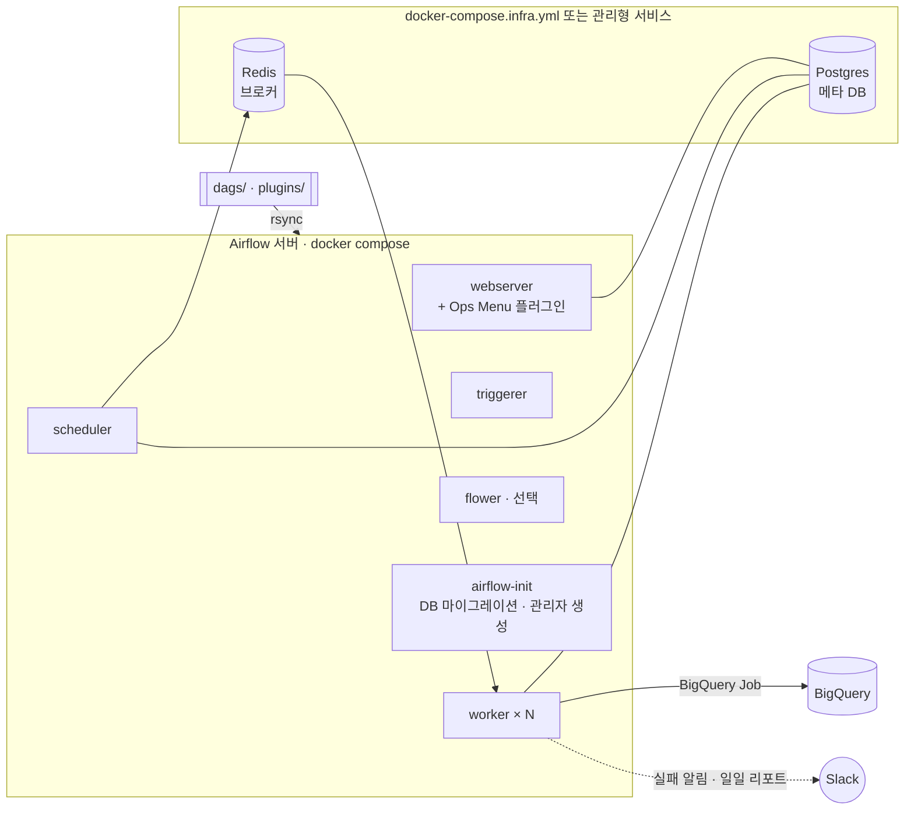

# Airflow Docker Platform

공식 `apache/airflow` 이미지로 CeleryExecutor 기반 Airflow 를 서버에 띄우고 운영하기 위한 구성입니다.
배포 구성, 웹 UI 운영 메뉴(플러그인), 운영 자동화 DAG, SQL 파일만으로 BigQuery 배치를 만드는 DAG 팩토리를
하나의 저장소에서 관리합니다.



## 구성 요소

| 경로 | 내용 |
|---|---|
| `docker-compose.yml` | webserver · scheduler · worker · triggerer · flower · airflow-init |
| `docker-compose.infra.yml` | Postgres(메타 DB) · Redis(브로커). 관리형 서비스를 쓰면 제외 |
| `plugins/` | 웹 UI 상단 **Ops Menu** — Backfill, Schedule Pause |
| `dags/maintenance/` | 메타 DB 정리, 로그 정리, 디스크 점검, 일일 실행 리포트 |
| `dags/sql_dag_factory.py` + `dags/sql/` | SQL 파일 1개 = BigQuery DAG 1개 자동 생성 |
| `dags/common/` | Slack 알림 콜백, DAG 공통 기본값 |
| `scripts/deploy.sh` · `.github/workflows/` | 서버 배포, CI(lint · 테스트 · compose 검증) |
| `tests/` | DAG 무결성, SQL DAG 규칙, 플러그인 웹 통합 테스트 |

## 빠른 시작

```bash
make init     # .env 생성 + Fernet/Secret 키 발급 → 비밀번호 값 수정
make up       # 최초 기동 시 airflow-init 이 DB 마이그레이션과 관리자 계정 생성
open http://localhost:8080
```

| 명령 | 동작 |
|---|---|
| `make scale n=3` | worker 수 조정 |
| `make restart` | 컨테이너 재생성 (worker 는 실행 중 태스크를 마친 뒤 종료) |
| `make logs s=airflow-scheduler` | 서비스 로그 |
| `docker compose --profile flower up -d flower` | Celery 모니터링 |

### 운영 환경 설정 (`.env`)

- **관리형 DB/Redis**: `COMPOSE_FILE=docker-compose.yml` 로 바꾸고 `AIRFLOW__DATABASE__SQL_ALCHEMY_CONN`,
  `AIRFLOW__CELERY__RESULT_BACKEND`, `AIRFLOW__CELERY__BROKER_URL` 을 지정합니다. airflow-init 이 DB 접속을 기다렸다가 마이그레이션합니다.
- **원격 로그**: `AIRFLOW__LOGGING__REMOTE_LOGGING=True` 와 버킷 경로를 지정하면 태스크 로그를 GCS/S3 에 보관합니다.
- **리버스 프록시**: `ENABLE_PROXY_FIX`, `FLOWER_URL_PREFIX` 를 켭니다. `AIRFLOW_BASE_URL` 은 외부 주소로 두어야 알림의 로그 링크가 열립니다.
- **신규 DAG 기본 상태**: `AIRFLOW_DAGS_PAUSED_AT_CREATION` — 스테이징은 `True`, 운영은 `False` 를 권장합니다.
- 비밀값은 모두 `.env`(서버 로컬)와 Airflow Connection 에만 두고 저장소에는 커밋하지 않습니다.

## Ops Menu 플러그인

`Admin`, `Op` 역할(`OPS_MENU_ROLES` 로 변경)만 접근할 수 있고, 모든 실행 이력은 `logs/ops_menu/history.jsonl` 에 남습니다.
변경 요청은 CSRF 토큰이 포함된 POST 로만 처리합니다.

**Backfill** — DAG, 기간, 모드를 골라 실행합니다.
- `backfill`: 해당 기간에 없는 실행을 생성 (`기존 dag run 리셋`, `실패 태스크만` 옵션)
- `clear`: 이미 있는 실행을 다시 수행
- DAG 존재 여부·날짜 형식·최대 기간(366일)을 검증하고, 셸을 거치지 않는 인자 목록으로 CLI 를 호출합니다.
- 웹서버 요청과 분리된 백그라운드 프로세스로 실행되어 긴 작업도 요청 타임아웃의 영향을 받지 않으며, 화면에서 로그를 실시간으로 확인합니다.

**Schedule Pause** — 오늘 특정 시간대에 실행 예정인 DAG 를 한 번에 일시정지/재개합니다.
원천 데이터 적재가 늦거나 DW 점검이 있을 때 연쇄 실패를 막는 용도입니다.
- 시간대 프리셋(00~07, 07~08 … 12~13, 오늘 전체) 또는 직접 입력
- 특정 태그 제외 (예: 원천 수집 DAG 는 계속 돌도록 `realtime` 태그 제외)
- 미리보기로 대상 목록을 확인한 뒤 적용
- 재개는 이른 시간대부터, 이전 시간대 완료를 확인하며 순서대로 진행

## 운영 자동화 DAG (`dags/maintenance/`)

| DAG | 주기 | 동작 | 설정 (Airflow Variable) |
|---|---|---|---|
| `maintenance_airflow_db_cleanup` | 매일 03:30 | `airflow db clean` 으로 오래된 메타 DB 레코드 삭제 | `maintenance_db_retention_days` (90) |
| `maintenance_airflow_log_cleanup` | 매일 04:00 | 보관 기간이 지난 로그 파일·빈 디렉터리 삭제 | `maintenance_log_retention_days` (30), `maintenance_log_cleanup_dry_run` |
| `maintenance_airflow_disk_check` | 6시간마다 | 디스크 사용률이 임계치를 넘으면 Slack 알림 | `maintenance_disk_alert_percent` (80) |
| `maintenance_airflow_daily_report` | 매일 10:00 | 전날 DAG 실행 결과를 상태별로 집계, 실패 DAG 목록과 함께 Slack 보고 | — |

## SQL DAG 팩토리

`dags/sql/` 아래에 SQL 파일을 추가하면 경로 규칙에 따라 스케줄이 정해진 BigQuery DAG 가 생성됩니다.
파이썬 코드는 수정하지 않습니다.

```
dags/sql/daily/09/mart_daily_active_users.sql          → 매일 09시
dags/sql/weekly/monday/10/mart_weekly_top_contents.sql  → 매주 월요일 10시
dags/sql/monthly/D1/09/mart_monthly_active_users.sql    → 매월 1일 09시
```

파일 머리 주석으로 설명, 태그, **선행 원천 테이블**을 선언합니다.

```sql
-- description: 일별 활성 사용자 수 집계
-- tags: mart, user
-- depends_on: my-project.raw.app_events:event_date

SELECT ... FROM `my-project.raw.app_events` WHERE event_date = '{{ target_date }}'
```

- `depends_on` 에 적은 테이블마다 대상 날짜 파티션이 적재됐는지 먼저 확인하고(30분 간격, 최대 3시간 재시도), 모두 준비되면 SQL 을 실행합니다.
- `{{ target_date }}` 는 실행 시점(설정 타임존) 기준 전날 `YYYY-MM-DD` 이며, Airflow 기본 매크로도 그대로 쓸 수 있습니다.
- 경로 규칙 위반, DAG id 중복, 잘못된 `depends_on` 형식은 테스트와 CI 에서 걸러집니다.
- GCP 연결은 `SQL_DAG_GCP_CONN_ID`(기본 `google_cloud_default`), 리전은 `SQL_DAG_BQ_LOCATION` 으로 지정합니다.

## DAG 작성 규칙

```python
from common.defaults import DEFAULT_ARGS, PLATFORM_START_DATE  # 실패 시 Slack 알림 포함

with DAG("my_dag", default_args=DEFAULT_ARGS, start_date=PLATFORM_START_DATE,
         schedule="0 9 * * *", catchup=False, tags=["mart"]):
    ...
```

CI 의 DAG 무결성 테스트가 다음을 검사합니다: import 오류 없음, `tags` 지정, `catchup=False`, 모든 태스크에 실패 알림 콜백.

Slack 은 Airflow Connection `slack_api_default`(Bot 토큰)로 연결하고, 채널은 `.env` 의 `ALERT_SLACK_CHANNEL`,
`REPORT_SLACK_CHANNEL` 로 지정합니다. 알림 전송이 실패해도 태스크 결과에는 영향을 주지 않습니다.

## 배포

```bash
DEPLOY_HOST=airflow.example.internal DEPLOY_USER=deploy DEPLOY_DIR=/srv/airflow scripts/deploy.sh             # DAG/플러그인 동기화
DEPLOY_HOST=... DEPLOY_USER=... WORKERS=3 scripts/deploy.sh --restart                                         # 컨테이너 재생성까지
```

- `dags/` 변경은 스케줄러가 주기적으로 다시 읽으므로 재시작 없이 반영됩니다.
- `plugins/` 나 compose 설정을 바꿨을 때만 `--restart` 를 씁니다.
- 서버의 `.env` 는 동기화 대상이 아닙니다.
- GitHub Actions `deploy` 워크플로(수동 실행)는 Environment(staging / production)별 변수와 SSH 키로 같은 스크립트를 실행합니다.

## 테스트

```bash
pip install -r requirements-dev.txt \
  -c https://raw.githubusercontent.com/apache/airflow/constraints-2.10.5/constraints-3.11.txt
make test
```

임시 SQLite 메타 DB 와 실제 Airflow 웹서버 앱으로 DAG 로딩, SQL 템플릿 렌더링 결과, 플러그인 권한(비로그인·Viewer 차단),
Schedule Pause 의 일시정지/재개 동작까지 검증합니다.

## 버전

Airflow 2.10.x 기준입니다. Ops Menu 는 Flask-AppBuilder 기반 플러그인 뷰를 사용하므로, Airflow 3 로 올릴 때는
플러그인을 FastAPI/React 기반 확장 방식으로 옮겨야 합니다.

## License

MIT
